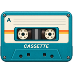
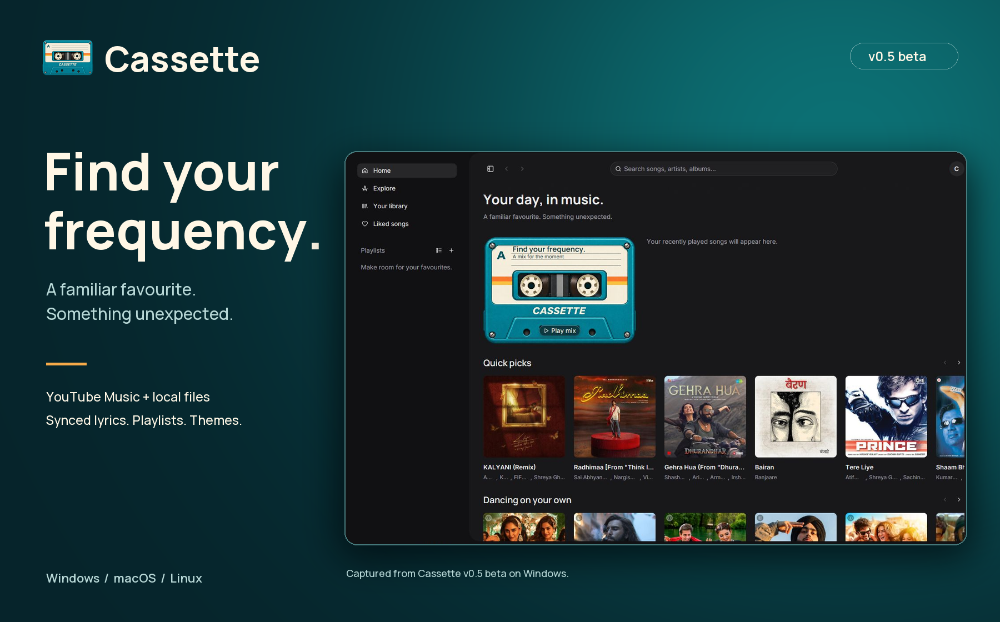
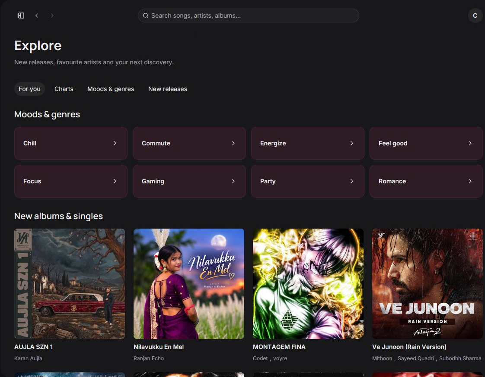

<p align="center">
  
</p>

<h1 align="center">Cassette</h1>
<p align="center"><strong>Find your frequency.</strong><br>A native desktop music player for YouTube Music and your local collection.</p>

<p align="center">
  <a href="https://github.com/ctrlcat0x/Cassette/releases/tag/v0.5.0-beta"><strong>Download v0.5 beta</strong></a>
  &nbsp; · &nbsp;
  <a href="https://github.com/ctrlcat0x/Cassette/releases">All releases</a>
  &nbsp; · &nbsp;
  <a href="https://github.com/ctrlcat0x/Cassette/issues">Report a problem</a>
</p>



Your familiar favourites and your next discovery, in one place. Browse YouTube Music, bring your own files, build playlists, and follow along with synced lyrics. Cassette pairs a native Rust and GPUI interface with a little cassette-tape character.

## Get the beta

**[Cassette v0.5 beta is available now.](https://github.com/ctrlcat0x/Cassette/releases/tag/v0.5.0-beta)** Choose the download for your machine:

| Platform | Download | Getting started |
| --- | --- | --- |
| Windows x64 | [Portable EXE](https://github.com/ctrlcat0x/Cassette/releases/download/v0.5.0-beta/cassette-windows-x64.exe) | Download and run `cassette-windows-x64.exe`. |
| macOS Apple Silicon | [DMG](https://github.com/ctrlcat0x/Cassette/releases/download/v0.5.0-beta/cassette-macos-arm64.dmg) | Open the disk image and drag Cassette into Applications. |
| Linux x64 | [DEB](https://github.com/ctrlcat0x/Cassette/releases/download/v0.5.0-beta/cassette-linux-x64.deb) | Built on Ubuntu 24.04. Install with `sudo apt install ./cassette-linux-x64.deb`. |

This is a beta: playback, provider availability, and account integrations may need further testing on your device. The macOS build is ad-hoc signed and is not notarized. Intel Mac and Linux ARM builds are not included in this release.

GitHub does not mark prereleases as **Latest**, so the repository sidebar may show only a tag. The beta remains available through the download links above and the [releases page](https://github.com/ctrlcat0x/Cassette/releases).

### Playback setup

The published v0.5 beta downloads require separate playback tools. New builds from this branch embed these tools directly into each EXE, DMG and DEB:

- Native CPAL output and Symphonia decoding handle playback; libopus is statically linked for Opus support.
- [yt-dlp](https://github.com/yt-dlp/yt-dlp#installation) resolves YouTube audio.
- [Deno](https://docs.deno.com/runtime/getting_started/installation/) supplies the JavaScript runtime used by yt-dlp.

Keep these tools on your `PATH`. Cassette also checks beside its executable and in an adjacent `runtime` directory. You can set a custom yt-dlp path in **Settings**. Keep the tools current when providers change their playback requirements.

Google sign-in on Windows also needs the [Microsoft Edge WebView2 Runtime](https://developer.microsoft.com/en-us/microsoft-edge/webview2/). You can browse without signing in; use the avatar menu to connect your YouTube Music account when you want library sync.

## Make room for your music

| Discover | Collect | Make it yours |
| --- | --- | --- |
| Search songs, albums, artists, and playlists on YouTube Music. Explore new releases, charts, and moods. | Bring in local music. Keep liked songs, playlists, listening history, and pinned downloads together. | Follow synced lyrics. Choose a theme, adjust the equalizer, or settle into the fullscreen player. |

Also included: queue controls, crossfade, system media controls, optional JioSaavn audio matching, and protected account-session storage.

<p align="center">
  
</p>
<p align="center"><sub>Actual Windows beta screenshots. Available music and artwork vary by provider and region.</sub></p>

## Build from source

Install [stable Rust](https://rustup.rs/) and the native build dependencies for your platform:

- **Windows:** Visual Studio C++ Build Tools, the Windows SDK and CMake.
- **macOS:** Xcode Command Line Tools.
- **Linux:** the GTK, WebKitGTK, graphics, audio, and D-Bus development packages listed in the [build workflow](.github/workflows/build.yml).

```sh
git clone https://github.com/ctrlcat0x/Cassette.git
cd Cassette
cargo run --release --locked
```

For a self-contained build, install Python 3.12 and CMake. No separate audio player is needed. Then run:

```sh
python scripts/bundle-runtime.py
cargo build --release --locked --features bundled-runtime --bin cassette
```

The bundled tools extract into Cassette's private data directory on first launch. `cassette --verify-runtime` checks the exact embedded executables. Custom tool paths in Settings still take priority.

The Cargo package and some internal modules retain the original project name, `raag`; the application binary is `cassette`.

## Development

Before opening a pull request:

```sh
cargo fmt --all -- --check
cargo clippy --all-targets --locked -- -D warnings
```

[GitHub Actions](https://github.com/ctrlcat0x/Cassette/actions/workflows/build.yml) builds Windows, macOS, and Linux packages and checks executable startup. Version tags matching `Cargo.toml` publish the three native files to GitHub Releases; tags with a prerelease suffix stay marked as prereleases.

Found something that needs attention? [Open an issue](https://github.com/ctrlcat0x/Cassette/issues) with your OS, app version, and steps to reproduce it. Please test GUI behaviour, playback, and sign-in on your target device; a successful build alone does not cover those flows.

The README artwork uses captured app screens. To regenerate the promotional composition, install Pillow and run `python assets/readme/render.py`.

## License and credits

Application source is licensed under [MIT](LICENSE). Dependencies and assets retain their own licenses, including [Inter](assets/fonts/inter-OFL.txt), [Manrope](assets/fonts/manrope-OFL.txt), [Iconoir](assets/icons/LICENSE), and [Hugeicons](assets/icons/HUGEICONS-LICENSE.txt). Music artwork belongs to its respective owners.
