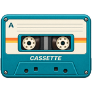

<p align="center"></p>

# Cassette

Cassette brings YouTube Music and your local music collection together in a native desktop player. Browse as a guest or connect your YouTube Music account to sync your library.

## Download

[Get the latest release](https://github.com/ctrlcat0x/Cassette/releases/latest)

| Platform | Install |
| --- | --- |
| Windows x64 | Run `cassette-windows-x64-setup.exe` and choose your Start menu and desktop shortcuts. Sign-in requires Microsoft Edge WebView2. |
| macOS Apple Silicon | Open the DMG and drag Cassette into Applications. The build is ad-hoc signed. |
| Linux x64 | On Ubuntu 24.04, run `sudo apt install ./cassette-linux-x64.deb`. |

## Features

- **Search and discover.** Find local tracks alongside YouTube Music songs, albums, artists, and playlists. Browse charts, moods, and new releases or start song radio.
- **Build your library.** Import tracks or folders, browse local albums in disc and track order, and rescan for updated tags and artwork. Like songs, make playlists and smart playlists, organize them in folders, and import or export local playlists.
- **Listen offline.** Pin songs and collections for offline playback. Search imported files and cached songs in Offline mode. Set a cache limit and clear unpinned audio.
- **Control what plays next.** Queue or reorder songs, clear upcoming tracks, shuffle collections, repeat a track or queue, and continue with similar songs. Cassette can restore your queue and position when you reopen it.
- **Tune playback.** Set audio output and quality, crossfade, loudness normalization, equalizer, and a sleep timer. Cassette supports system media controls and Windows taskbar controls.
- **Follow the lyrics.** See synced lyrics, word timing, translations, and romanization when available. Adjust timing or import corrected lyrics.
- **Make it yours.** Choose a theme, accent, language, and interface scale. Use the sidebar, bottom player, or fullscreen player, and reduce motion if you prefer.
- **See your listening story.** Review recently played songs and your top tracks, artists, and albums. A private session pauses local history, listening stats, history sync, and automatic caching.

## Shortcuts

| Keys | Action |
| --- | --- |
| Ctrl/⌘ + K | Focus search |
| Ctrl/⌘ + O | Import local files |
| Ctrl/⌘ + B | Toggle sidebar |
| Ctrl/⌘ + , | Open Settings |
| Ctrl + Q on Windows/Linux, ⌘ + J on macOS | Toggle queue |
| Ctrl/⌘ + L | Toggle lyrics |
| Ctrl/⌘ + Left or Right | Previous or next track |
| Space | Play or pause |
| M | Mute or unmute |
| F11 | Toggle fullscreen player |

## Build from source

Install stable Rust, Python 3.12, and CMake. Windows also needs Visual Studio C++ Build Tools and the Windows SDK. macOS needs Xcode Command Line Tools. See the [build workflow](.github/workflows/build.yml) for Linux packages.

```sh
python scripts/bundle-runtime.py
cargo build --release --locked --features bundled-runtime --bin cassette
```

The executable is in `target/release`. Release builds bundle yt-dlp and QuickJS-NG. For development, run `cargo run --locked` with yt-dlp and a supported JavaScript runtime on your PATH.

Built with Rust, GPUI Kit, CPAL, and Symphonia. [MIT License](LICENSE)
